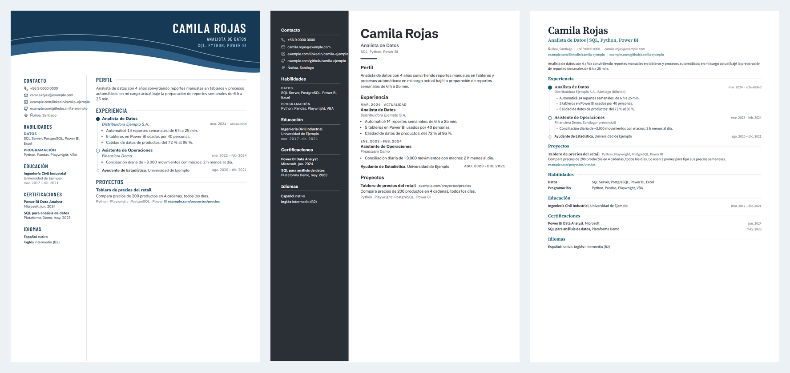

# cv-builder

Skill de [Claude Code](https://claude.com/claude-code) para hacer CVs de una página que se ven bien **y** que leen
bien los sistemas de selección (ATS). Cada persona tiene un perfil base con todo lo que ha hecho, y de ahí salen
versiones según el cargo al que postula (data, desarrollo, automatización, procesos, operaciones, liderazgo,
infraestructura).



## Qué hace

- **Datos primero, diseño después.** El perfil es un YAML con el formato [JSON Resume](https://jsonresume.org) más
  algunas extensiones (cifra de cada logro, etiquetas, fuente del dato). Las versiones solo eligen, ordenan y redactan.
- **Pregunta antes de escribir.** Parte con «¿qué estás buscando?» y anota lo que falta (cifras, fechas que no
  coinciden) como preguntas para la persona.
- **Plantillas y temas.** Cuatro plantillas (`ola`, `lateral`, `ruta` y `clasica`, la de máximo ATS), 6 paletas y
  3 pares de fuentes libres incluidas, que funcionan sin internet.
- **Chequeo ATS en cada render.** Una página, el nombre primero en el texto del PDF, cada sección seguida de su
  contenido, datos de contacto sin cortes, links clickeables y logros sin cifra.
- **Ajuste automático** de la letra para que quepa en una página (hasta 94 %; si no alcanza, avisa que hay que recortar).
- **Banner de LinkedIn** (1584 × 396) con el mismo tema del CV: cifras, trayectoria o frase, con chequeo de que nada
  quede bajo la foto de perfil.
- **Muestrario y página para elegir.** Genera todas las combinaciones de diseño y una página donde la persona elige,
  mira el resultado y descarga el PDF.

## Requisitos

- Python 3.11 o superior
- `pip install -r cv-builder/scripts/requirements.txt`
- `python -m playwright install chromium` (renderiza HTML → PDF)

## Instalar como skill

```bash
git clone https://github.com/<usuario>/<repo>.git
# Opción A: solo en este proyecto → ya funciona (Claude Code lee cv-builder/SKILL.md desde aquí)
# Opción B: para todos tus proyectos
cp -r cv-builder ~/.claude/skills/cv-builder
```

Después basta pedirle a Claude Code algo como «hazme un CV para un cargo de analista de datos» y la skill guía el resto.

## Probar con la persona de ejemplo

```bash
python cv-builder/scripts/render.py perfiles/ejemplo/cvs/data.yaml
# → perfiles/ejemplo/cvs/salida/: data.pdf, data.png, data.html, data.json (JSON Resume)
```

`perfiles/ejemplo/` es ficticio. Tus perfiles reales van en `perfiles/<tu-nombre>/` y **nunca se suben**: el
`.gitignore` es una lista blanca que solo publica el ejemplo.

## Scripts

| Script | Para qué |
|---|---|
| `render.py <version.yaml>` | Genera el CV (PDF, PNG, HTML, JSON Resume) y corre el chequeo. `--borrador` marca lo que falta; `--listar` muestra plantillas y temas |
| `validar.py [perfiles/<persona>]` | Revisa esquema, ids cruzados, fechas y logros sin cifra |
| `nuevo_perfil.py <persona> [--version <objetivo>]` | Crea la carpeta de una persona o una versión nueva desde plantillas |
| `muestrario.py perfiles/<persona>` | Todas las combinaciones de diseño, empaquetadas para la página de elección |
| `estudio.py <version.yaml>` | Estudio local: cambia plantilla y tema con vista previa en vivo |
| `banner.py <version.yaml>` | Banner de LinkedIn con el tema del CV (estilos `cifras`, `ruta` y `frase`) |
| `chequeo_publico.py` | Antes de cada commit: busca datos personales en lo que se va a publicar |

## Estructura

```
cv-builder/            la skill
├── SKILL.md           flujo completo para Claude
├── references/        objetivos por cargo, referencias de CVs, reglas de plantillas, diagnóstico de un CV
├── schema/            JSON Schema del perfil y de las versiones, y plantillas para empezar
├── templates/         plantillas HTML/CSS, temas (temas.yaml), íconos SVG y fuentes (OFL)
├── scripts/           render, validación, muestrario, estudio, banner
├── estudio/           página del estudio local
├── banners/           plantilla del banner de LinkedIn
└── elige/             página «Elige tu CV»
perfiles/ejemplo/      persona ficticia para probar
```

## Privacidad

- Los datos de cada persona viven solo en `perfiles/<persona>/` en tu computador.
- `chequeo_publico.py` corre como hook `pre-commit` (`python cv-builder/scripts/chequeo_publico.py --instalar`). Saca
  los nombres, correos, teléfonos y empresas de tus perfiles reales y bloquea el commit si alguno aparece en lo que se
  va a publicar. También busca RUT, teléfonos, rutas de tu PC y cosas con forma de clave.

## Licencias

- Código: MIT (ver `LICENSE`).
- Fuentes en `cv-builder/templates/fonts/`: SIL Open Font License; cada una lleva su `OFL-*.txt`.
